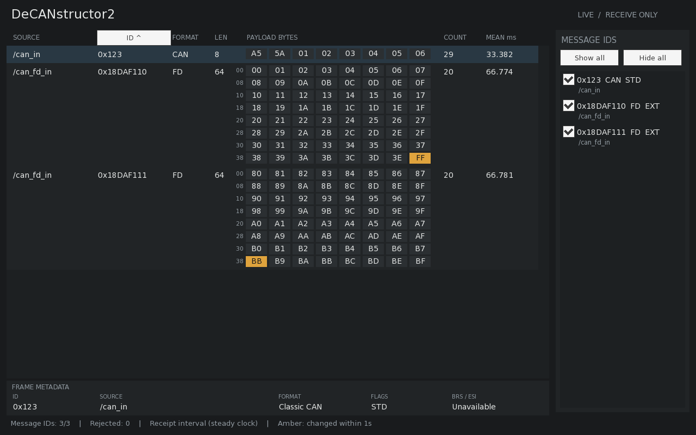

# DeCANstructor2

DeCANstructor2 is a receive-only ROS 2 graphical monitor for classic CAN and
CAN-FD messages. It supports Humble, Jazzy, Kilted, Lyrical, and Rolling.
A separate CAN driver or ROS publisher supplies the messages; the package does
not transmit frames or decode DBC files.



*Actual application capture using synthetic ROS messages.*

## Build

Install ROS 2 for your distro, `git`, `python3-vcstool`, `python3-rosdep`,
`python3-colcon-common-extensions`, and the development tools for your platform.
Initialize rosdep if necessary (`sudo rosdep init`, then `rosdep update`). In a
new workspace, import the vendor dependency from the repository manifest:

```bash
export ROS_DISTRO=jazzy  # or humble, kilted, lyrical, rolling
source /opt/ros/$ROS_DISTRO/setup.bash
mkdir -p ~/dc2_ws/src
cd ~/dc2_ws
git clone https://github.com/JWhitleyWork/decanstructor2.git src/decanstructor2
vcs import . < src/decanstructor2/external.repos
rosdep install --from-paths src --ignore-src -r -y
colcon build --cmake-args -DCMAKE_BUILD_TYPE=Debug
source install/setup.bash
```

Tests are enabled by default; install `xvfb` and `xauth` before building.
To build without tests, add `-DBUILD_TESTING=OFF` to the CMake arguments.
The build installs the package into the workspace's `install/` directory.
Source `~/dc2_ws/install/setup.bash` in each new terminal before using it.

## Documentation

- [Monitor guide](docs/monitor.md): launching, topic configuration, controls and
  display reference.
- [Contributing](CONTRIBUTING.md): development checks, tests and GUI validation.

The `docs/` directory, including screenshots, is also installed under
`share/decanstructor2/docs/` in the package prefix.
