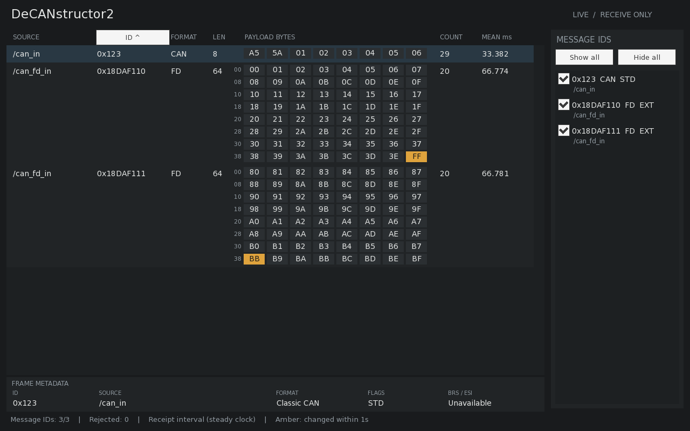

# Using the monitor

DeCANstructor2 displays classic CAN and CAN-FD messages received from ROS 2.
It does not transmit CAN frames. See the repository's
[build and installation instructions](https://github.com/JWhitleyWork/decanstructor2#build)
if the package is not installed yet.

## Launch and configure topics

After sourcing the workspace's `install/setup.bash`, start the monitor:

```bash
ros2 run decanstructor2 decanstructor2_node_exe
```

The `classic_topic` parameter defaults to `can_in` (`can_msgs/msg/Frame`), and
`fd_topic` defaults to `can_fd_in` (`ros2_socketcan_msgs/msg/FdFrame`). Set either
parameter to an empty string to disable that subscription. For example, to
receive classic CAN only:

```bash
ros2 run decanstructor2 decanstructor2_node_exe --ros-args -p classic_topic:=can_in -p "fd_topic:=''"
```

Both subscriptions use best-effort QoS. Classic frames support up to 8 data
bytes and CAN-FD frames up to 64. A separate driver or ROS publisher must supply
the messages; the monitor does not provide a CAN driver or decode DBC files.

## Layout



*Actual application capture using synthetic ROS messages, not a design mockup.*

- **Main table:** one row per message identity, with source, numeric CAN ID,
  format, payload length, payload bytes, receive count and mean receipt interval.
- **MESSAGE IDS:** the permanent right-hand checklist controls which rows appear
  in the table. It is available directly in the main window; no dialog is needed.
- **FRAME METADATA:** the horizontal panel beneath the main table describes the
  selected row. It shows ID, source, format, flags and BRS / ESI availability,
  not a second payload inspector.
- **Status bar:** visible/total message IDs, rejected frames and timing/highlight
  reminders.

The layout is checked at 1280×800 and at the narrower 1000×600 size. Longer
message lists scroll; visible FD payloads remain expanded.

## Show or hide message IDs

1. Find the entry in **MESSAGE IDS**. Its checkbox line shows the ID, classic/FD
   format and flags; the source appears beneath it. Hover over either line for
   the complete entry, including a source that does not fit the sidebar.
2. Uncheck it to remove only that row from the main table. Check it again to
   restore the row with its latest data.
3. Use **Hide all** or **Show all** to change all entries currently known to the
   checklist. The checklist itself stays visible when the table is empty.

These are display controls, not subscription controls. Hidden messages keep
updating their receive count, interval, payload and byte-change timestamps.
Restoring a row does not restart its highlight timer. A message first discovered
after **Hide all** starts visible; existing hidden entries remain hidden.
Visibility choices are not saved across application restarts.

The same numeric ID can appear more than once. Entries remain independent when
source (topic and `header.frame_id`), classic/FD format, or flags differ. Hiding
one entry does not hide all other messages with that numeric ID. The status
bar's visible/total count counts these distinct entries, not unique numeric IDs.
Rejected messages are counted separately, not as hidden rows. The monitor holds
at most 4096 entries; after that, new identities are rejected while existing
ones continue updating.

## Sort and select rows

The **ID ^ / ID v** column header toggles ascending/descending numeric CAN ID
order. Equal-ID entries keep a deterministic order by source and the remaining
identity fields. The checklist follows the same order, including hidden entries.

Click a table row to inspect it in **FRAME METADATA**. Sorting, late arrivals,
or hiding a different row preserves the selected message identity. Hiding the
selected row clears the metadata to **Select a frame**; showing that row again
does not automatically reselect it. The first nonempty table initially selects
its first row.

Explicit sorting and visibility changes scroll the table back to the top.
Ordinary message updates do not reset it. For windows narrower than the checked
layout, a horizontal table scrollbar preserves the payload cell widths.

## Read payloads, timing and metadata

- **Classic CAN:** a compact row shows up to eight payload bytes.
- **CAN FD:** every row shows an inline 8×8 byte matrix, even when it is not
  selected. Hexadecimal offsets at the left identify the start of each byte row.
- **Unused bytes:** `--` marks an absent byte. It is not a received zero.
  Classic remote-request frames do not display invented payload bytes.
- **Amber cells:** a byte changed within the last second. Showing a hidden row
  after that interval has elapsed does not make the old change amber again.
- **COUNT:** accepted receptions for that entry, including receptions while
  hidden. It is not a bus-wide count or a guarantee that every published message
  was received; the subscriptions use best-effort QoS.
- **MEAN ms:** the mean interval between receptions measured with a steady clock,
  not a bus timestamp. `--` means no interval is available yet.
- **FLAGS:** `STD` / `EXT` identify standard/extended IDs; `ERR` and `RTR`
  identify error and classic remote-request flags where present.
- **BRS / ESI:** shown as **Unavailable** because the ROS `FdFrame` message used
  by this application does not expose those flags. Unavailable does not mean
  those bus flags were observed as false.

The metadata source field has a tooltip for its full value. Payloads remain in
the table so inspecting metadata never requires collapsing another FD row.

## Exit

Press **Escape**, close the application window, or press **Ctrl+C** in its
launching terminal. For developer checks of layout, filtering and shutdown,
see the repository's
[GUI validation guide](https://github.com/JWhitleyWork/decanstructor2/blob/main/CONTRIBUTING.md#gui-validation).
